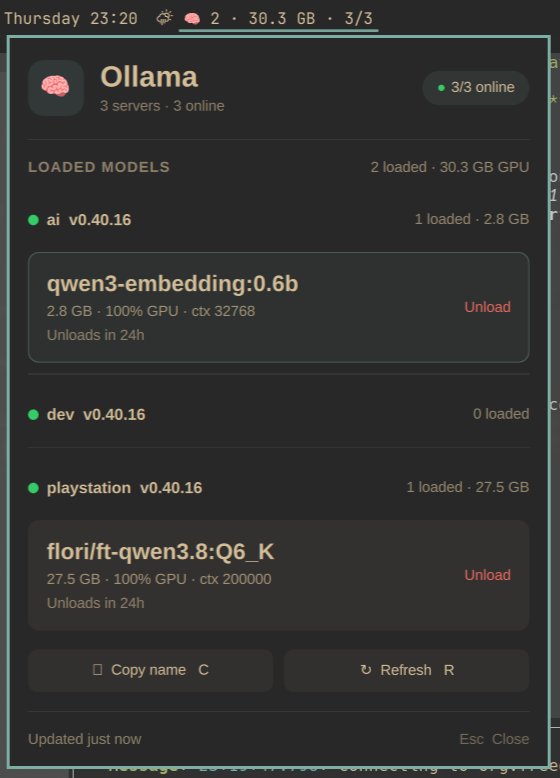
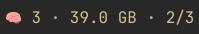
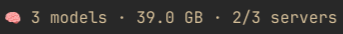

# Ollama PS

A slim Omarchy bar widget showing Ollama's loaded models on each server, server
version, and availability. It uses Ollama's documented `GET /api/ps` endpoint
via the `ollama-ruby` gem.

## Compatibility

Built for Omarchy's Quattro/Quickshell bar plugin host, using its shared
third-party service and standard panel lifecycle APIs. The optional
copy-model-name action uses `wl-copy` from `wl-clipboard`.

## Preview



Panel view: three servers (two online, one unreachable), loaded models with
VRAM and expiry, and the copy/refresh footer.

## Bar readout

The bar shows aggregate loaded models, total GPU memory, and server
availability across all configured servers.

**Compact** (`compactMode: true`) — `🧠 3 · 39.0 GB · 2/3`



**Full** (`compactMode: false`, default) — `🧠 3 models · 39.0 GB · 2/3 servers`



On vertical bars the label is replaced by the brain icon alone, regardless of
`compactMode`. The counts and VRAM always report **all** loaded models, not
just the rows shown in the panel (see `maxDisplayedModels`).

## Setup

1. Install [Ollama](https://ollama.com) and start it in the way you prefer (a
   user service, a terminal, or another supervisor).
2. Ensure `ruby` (4.x) is available (asdf, rbenv, mise, or distro). The
   `ollama-ruby` gem is installed automatically on first run. Install
   `wl-clipboard` as well if you want the copy-model-name action.
3. Install and enable the plugin:

```bash
omarchy plugin add https://github.com/flori/omarchy-ollama-ps.git --enable
```

4. Add **Ollama PS** to a bar section if it is not placed automatically.

Configure servers via the `servers` object in `~/.config/omarchy/shell.json`:

```json
{
  "flori.ollama-ps": {
    "servers": {
      "local": "http://localhost:11434",
      "remote": "http://192.168.1.50:11434"
    }
  }
}
```

The Ruby transport uses the [`ollama-ruby`](https://github.com/flori/ollama-ruby) gem, which accepts any `base_url`.

## How it works

The `ollama-ps.sh` wrapper resolves the Ruby interpreter (asdf/rbenv/mise
shims, then distro paths) under Quickshell's `clearEnvironment: true`,
auto-installs the `ollama-ruby` gem on first run, and `exec`s
`ollama-ps.rb`. Ruby fans out to all configured servers concurrently
via `Thread`, computes honest model counts and VRAM totals before
trimming, then returns the curated list to the QML layer. No daemon,
no background polling beyond the `refreshIntervalSec` cycle.

## Requirements

- Ruby 4.x (asdf, rbenv, mise, or distro)
- `ollama-ruby` gem — installed automatically by the wrapper on first run
- `wl-clipboard` (`wl-copy`) — optional, only for the copy-model-name action
- A running Ollama server — see Setup for configuration

No daemon, no elevated privileges.

## Usage

- **Left click** — opens the panel and triggers a refresh.
- **Right click** — toggles compact/full bar label.
- **Arrow keys** — select a loaded model.
- **Enter** ×2 (or click ×2) — confirm unloading the selected model.
- **R** — refresh all servers.
- **C** — copy the selected model's name to the Wayland clipboard.
- **Esc** — close the panel.
- **Tab** / **Shift+Tab** — switch between panels.

Models without an actionable canonical name remain visible but cannot be
copied or unloaded. The summary reports total loaded models and aggregate
VRAM across all servers. The service does not start or stop Ollama — that
policy belongs to your setup.

## Configuration

Each bar-widget entry is configured with keys under the
`flori.ollama-ps` object in `~/.config/omarchy/shell.json`:

| Key | Type | Default | Meaning |
|---|---|---|---|
| `servers` | object | `{}` | Map of server name → `base_url` (see Setup). |
| `refreshIntervalSec` | int (5–300) | `15` | Poll cadence in seconds. |
| `maxDisplayedModels` | int (≥ 1) | `12` | **Global** row budget across all servers, kept by latest expiry. |
| `compactMode` | bool | `false` | Shorten the horizontal bar label; vertical bars stay icon-first. |

```json
{
  "flori.ollama-ps": {
    "servers": { "local": "http://localhost:11434" },
    "refreshIntervalSec": 15,
    "maxDisplayedModels": 12,
    "compactMode": false
  }
}
```

`maxDisplayedModels` caps only the rows rendered in the panel; the bar's
model count and VRAM always report every loaded model, so a server with 50
loaded shows "50" even when only 12 rows are listed. When several bar
instances are active, the lexically first registered source wins and stays
stable across monitors.

## Removal

Remove the plugin with the canonical Omarchy command:

```bash
omarchy plugin remove flori.ollama-ps
```

## License

MIT — see [LICENSE](LICENSE).

## Credits

Based on [Brams-s/omarchy-ollama-status](https://github.com/Brams-s/omarchy-ollama-status)
(MIT). This fork replaces the Python transport with Ruby, adds multi-server
concurrent fan-out, a global display-budget curation system, and the
self-healing interpreter wrapper.
